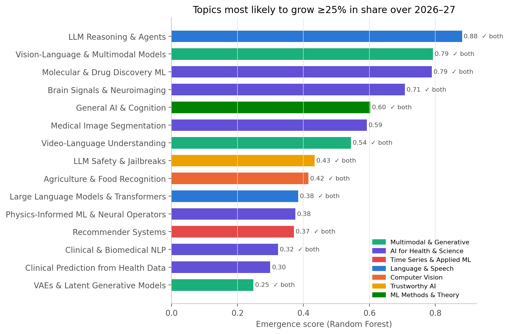
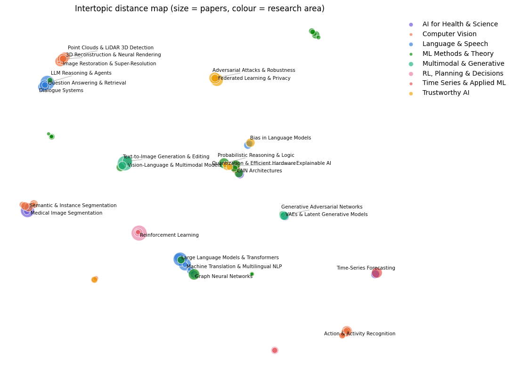
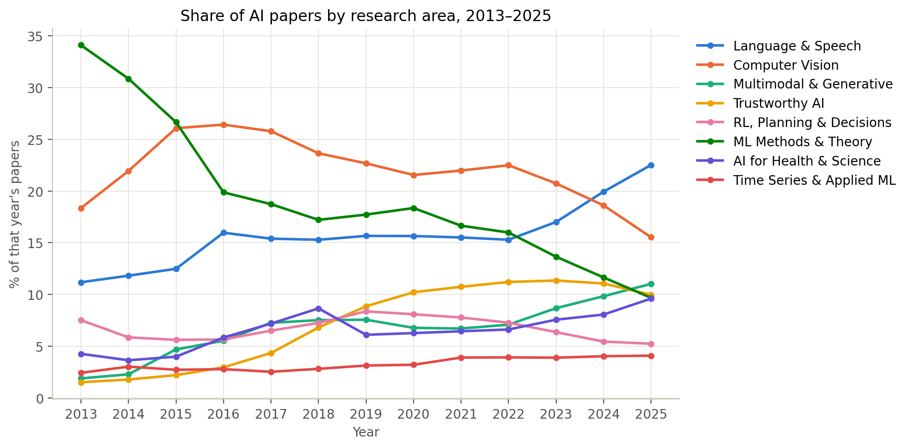
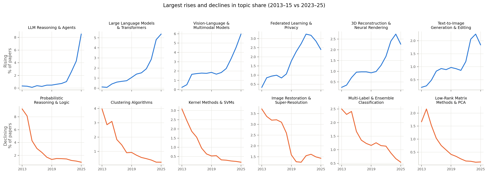
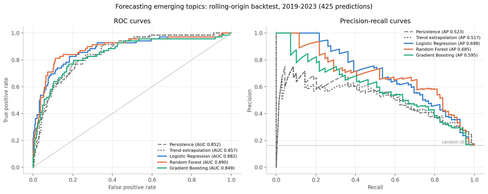
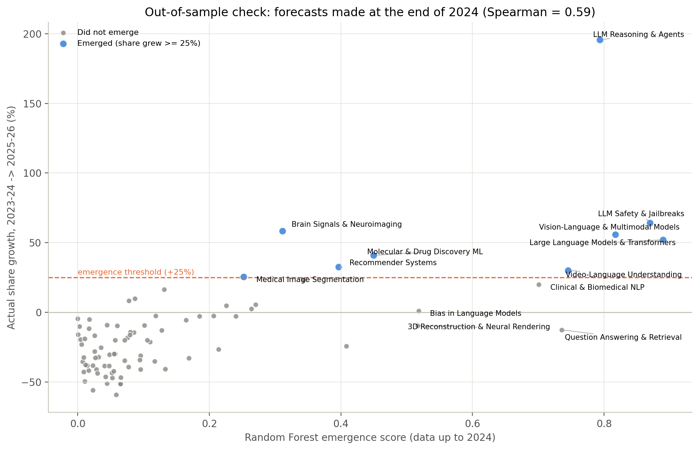

# Forecasting Emerging Research Topics in AI

Topic modelling and trend forecasting on **378,796 arXiv AI papers (2013–2025)**, tested on **80,775 unseen papers from 2026**.

**Question:** using only data up to year T, can we predict whether a research topic's share of AI papers will grow by at least 25% over the next two years?

**Answer:** yes, better than simple momentum rules. A Random Forest beat a persistence baseline in a rolling backtest and stayed ahead on genuinely unseen 2025–26 data.

📄 Full report: [`report/Forecasting_Emerging_AI_Topics_Report.pdf`](report/Forecasting_Emerging_AI_Topics_Report.pdf)
📓 Notebook: [`ai_trend_detection.ipynb`](ai_trend_detection.ipynb)

---

## Key results

| | Persistence baseline | Random Forest |
|---|---|---|
| Backtest PR-AUC (2019–2023, 425 predictions) | 0.523 | **0.685** |
| Backtest ROC-AUC | 0.852 | **0.890** |
| Out-of-sample PR-AUC (forecast made with data up to 2024) | 0.702 | **0.844** (0.809 after outlier adjustment) |

- The PR-AUC gain over persistence is **+0.150 (95% CI 0.051 to 0.250)**, from a topic-level bootstrap.
- In the out-of-sample test, **6 of the Random Forest's top 10 picks emerged**.
- Semantic and venue signals add the most beyond momentum: +0.10 PR-AUC for Logistic Regression and +0.05 for Random Forest.
- **Forecast for 2026–27:** LLM reasoning & agents, vision–language models, molecular & drug discovery, and brain signal analysis lead the list.
- The share of 2026 papers that fit none of the 85 topics rose from 14.9% in January to 22.5% in September. Clustering them shows new directions such as video generation, AI research agents and the governance of agentic AI.



---

## What makes this project careful

- **No leakage.** An earlier version used the topic ID as a feature, which inflated accuracy. Here no feature identifies the topic, and every forecast is tested only on years after its training data (rolling-origin evaluation).
- **Simple baselines and confidence intervals.** Every model is compared against persistence and trend extrapolation, with paired bootstrap intervals.
- **A true out-of-sample test.** The 2026 papers were never used for topic modelling, training or tuning.
- **A data problem found and fixed.** A 2013 bulk upload of old UAI conference papers (1,033 papers, mostly from 1985–2001) made one topic look like 29.8% of all 2013 AI papers. After removing them from the trend analysis, it is 9.2%.
- **Shares, not counts.** AI output grew about 24 times over the period, so trends are measured as each topic's share of all AI papers that year.
- **Choices made by measurement.** The embedding model, number of topics and outlier threshold were each chosen by comparing coherence (NPMI), diversity and outlier rate.

---

## Pipeline

1. **Data.** arXiv metadata snapshot (Kaggle, Cornell University). Papers with a primary AI category (cs.AI, cs.LG, cs.CL, cs.CV, stat.ML), dated by first version, with abstracts of at least 30 words.
2. **Embeddings.** `all-MiniLM-L6-v2`, chosen over MPNet and SPECTER after a direct comparison.
3. **Topics.** BERTopic (UMAP + HDBSCAN) fitted on a year-balanced sample of 39,000 papers, then applied to all papers. The result is 85 topics (NPMI 0.130, diversity 0.660), named by hand and grouped into 8 research areas.
4. **Trends.** Each topic's share of all AI papers per year, 2013–2025.
5. **Forecasting.** 12 features (trend, authors, semantic novelty, venue mentions), 680 labelled topic-years, and 5 models (2 baselines, Logistic Regression, Random Forest, Gradient Boosting).
6. **Validation.** Rolling backtest 2019–2023, ablation, permutation importance, and an out-of-sample test on 2025 plus January–September 2026.



---

## Figures

| | |
|---|---|
|  |  |
| Share of papers by research area | Largest rises and declines in topic share |
|  |  |
| ROC and precision–recall curves (backtest) | Forecast at end of 2024 vs actual growth |

All figures produced by the notebook are in [`figures/`](figures/).

---

## How to run

1. Open the notebook on [Kaggle](https://www.kaggle.com) and add the dataset **arXiv** by Cornell University (`arxiv-metadata-oai-snapshot.json`) as input.
2. Turn on a GPU accelerator.
3. Run all cells. The notebook installs the extra libraries itself (listed in `requirements.txt`).

- `USE_CACHE = False` rebuilds everything from the raw data, in under an hour on a Kaggle GPU.
- `USE_CACHE = True` reuses saved embeddings and the topic model.
- A fixed seed (42) makes the results reproducible.

The arXiv snapshot keeps growing, so a newer copy of the dataset will give slightly different counts.

## Repository contents

```
ai_trend_detection.ipynb   full analysis, with outputs
report/                    full written report (PDF)
figures/                   all figures produced by the notebook
requirements.txt           extra libraries installed by the notebook
```

## Data

arXiv metadata snapshot published on Kaggle by Cornell University. The data is not included in this repository because of its size.
